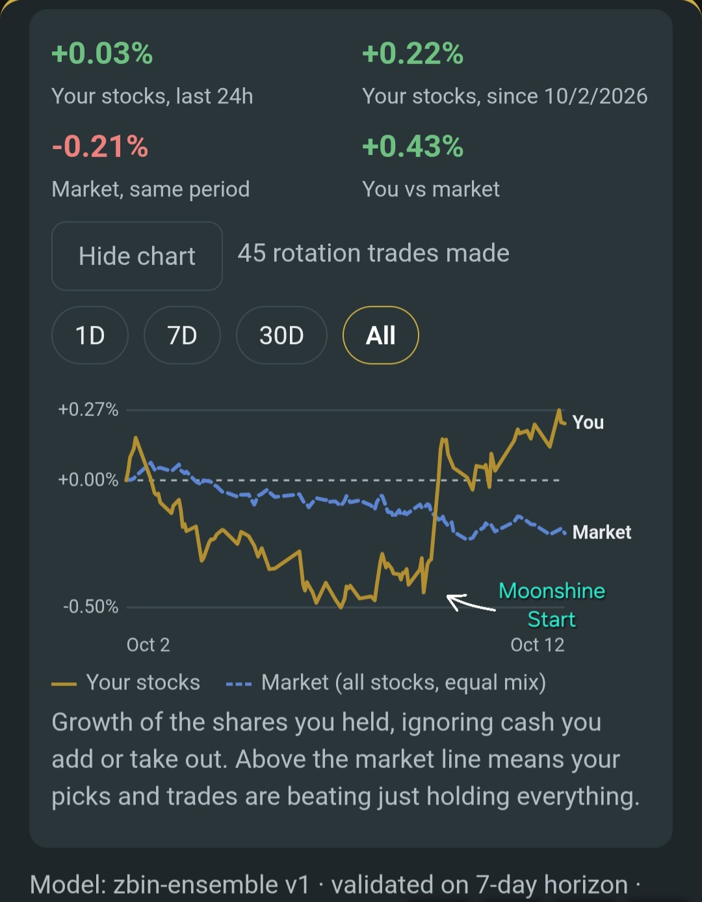
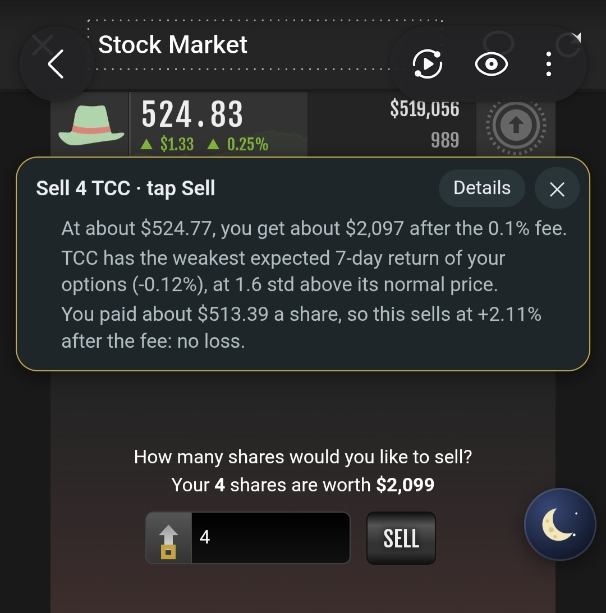
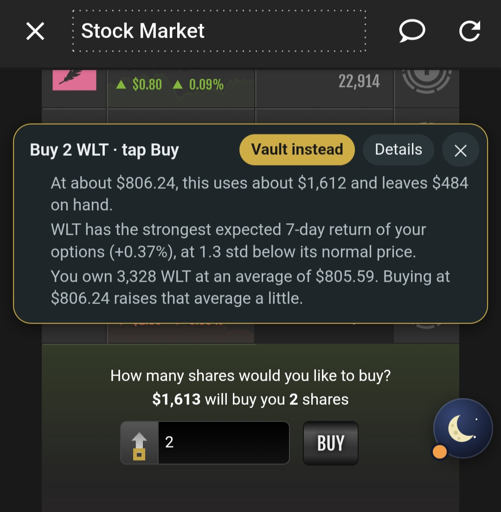

# 🌙 Moonshine Asset Manager

**An all-in-one stock market tool for Torn City, built for Torn PDA.**

In Torn, cash on hand gets mugged, so most players keep their money in the stock market. Moonshine makes that fast and smart. Get cash out in a couple of taps, put it back just as quickly, and let the script look for small, tested trades so money you keep in stocks earns a little instead of sitting idle. **For savings you won't need for a while, Torn's City Bank pays more; see [Stocks or the bank?](#stocks-or-the-bank).**

It fills in the numbers. **You always press Torn's own Buy, Sell or give button.**

---

## Screenshots

<p align="center">
  
</p>

**Growth chart, Oct 2 – Oct 12, 2026.** The arrow marks when I started following Moonshine's trade suggestions. Before that, my stocks trailed the market. After 45 rotation trades, they're up **+0.22%** while the market is down **-0.21%**, a lead of **+0.43%**.

*Early days: this is about 10 days of data, and past results don't guarantee future ones.*

<table>
<tr>
<td width="50%" valign="top">

<p><b>Withdraw.</b> It picks a stock that's worth more than you paid, even after the fee, fills in the exact share count, and tells you why. You tap Sell.</p>
</td>
<td width="50%" valign="top">

<p><b>Deposit.</b> It buys the stock with the best outlook, shows your average price paid, and offers the faction vault instead. You tap Buy.</p>
</td>
</tr>
</table>

---

## Features

### 💵 Quick withdraw
Type how much cash you need, like `5m`, `750k` or `1.2b`. The script picks which stock to sell, opens its panel and fills in the exact number of shares, including the 0.1% selling fee and a small safety margin for price changes.

- **It sells stocks that are in profit first.** The script knows what you paid for your shares, and picks a stock worth more than you paid even after the 0.1% fee, so using the market as a bank doesn't cost you money. If every stock is below what you paid, it picks the smallest loss and tells you how much.
- Among those, it sells the stock with the weakest outlook.
- It never sells shares that are holding a benefit block. If it can't avoid that, it warns you and offers other stocks.
- If no single stock has enough spare shares, it splits the withdrawal into separate sales and walks you through each one.

### 🏦 Quick deposit
One tap reads the cash you're carrying and buys as many whole shares as it covers of the stock with the best outlook. Extra weight goes to purchases that complete a benefit block.

- **Only good buys.** If no stock is expected to rise, it says *No good buys right now* and suggests the faction vault instead of buying into a falling stock.
- **Leftover cash.** After a purchase, if there's enough left for more shares of a good buy, it offers to buy them. Otherwise it offers the faction vault, or the church for small amounts.
- **Faction vault.** Deposit to your faction's vault in one tap. The script opens Faction → Armory (the revolver tab) and fills in the money box; you tap **Deposit Money**. Only shown if you're in a faction, and not while you're in hospital, jail or traveling.
- **Church.** Cash too small for a share can be donated to the church. The script opens the Donate tab and fills in the amount. A last resort: only suggested when the cash can't buy even one share of any stock, and only up to $500, because a donation gives the money away. A cheap share keeps it.

### 📈 Trade ideas
The script looks for chances to **sell a little of one stock and buy another** for a small expected gain. Each idea shows:

- How much to sell and what to buy
- The estimated gain after the fee
- How strong the evidence is
- A plain-English reason, such as *"ABC is 2.1 standard deviations below its 7-day normal price; when it was here before, it rose 68% of the time"*

You confirm the sale, then confirm the purchase. Nothing happens without your two taps.

### 🏛️ Bank advisor
Torn's City Bank pays more than stocks for money you can lock away. Tap **Bank** in the moon menu to see:

- **Your investment** and when its term ends.
- **How much can move.** Everything in stocks except shares held for benefit blocks and the amount you choose to keep in stocks (Settings, default $10M).
- **What to sell.** Stocks expected to be in profit after the 0.1% fee when your term ends, based on today's price and the model's outlook, with how many shares, what you get and the profit you lock in. Sales under $1M are skipped, so you don't tap through lots of tiny ones. Stocks expected to be below what you paid are listed separately and not suggested, with how many days of interest it would take to make the loss back. While your term is running, the plan is a preview: prices will move, and selling unlocks when the term ends.
- **Your stock wallet.** Deposits and withdrawals made with Moonshine since your last bank move (or over one bank term), the most you've drawn at once, profit locked in by withdrawals, and how much your stocks' prices gained or lost. Also your stocks' growth over the last 7 days and 2 months. It then suggests how much to keep in stocks to last the whole bank term: $5M that always stays for trading, plus your average weekly withdrawals × 1.5 × the weeks in the term (8 for a 2-month term), or the most you've drawn at once if that's bigger, rounded up to the next $1M. Withdraw $5M a week on a 2-month term? It suggests $5M + $7.5M × 8 = $65M. One tap applies it.
- **What the bank pays.** Interest on the money you move, and on your whole investment for a 1-week term (per week and renewed for 2 months) and a 2-month term, so you can compare. Your rate is worked out from Torn's current rate and your Bank Interest merits, or you can type in the rate from your bank page.

Tap **Start selling** and it walks you through each sale like a withdrawal, then offers a button to open the bank. While a term is running the plan is shown but selling waits until it ends, since Torn allows one investment at a time.

### 📊 Growth tracking
A chart shows how your stocks have grown compared with the whole market, over 1 day, 7 days, 30 days or all time. It ignores cash you add or take out, so a withdrawal never looks like a loss. If your line stays above the market's over weeks, your trades are working.

### 🌙 Out of the way
Everything sits behind one small moon icon. Drag it to any edge of the screen. Tap it to open **Market**, **Withdraw**, **Deposit** and **Bank**.

- 🟠 An orange dot means you're carrying cash.
- 🟢 A green dot means there's a trade idea.
- 🟣 A purple dot means your bank term ends within 24 hours or has ended (or nothing is invested and there's money worth moving).

The panels follow Torn's light or dark mode, and they collapse into a thin bar at the top so they never cover Torn's buttons.

---

## How it works

### 1. Collecting prices
- **From Torn:** While any Torn page is open, the script reads stock prices from the official Torn API about once a minute and saves them on your phone.
- **History:** On first run it downloads up to 2 years of hourly prices from [tornsy.com](https://tornsy.com/api), a free public Torn stock-history site. This takes about 5–10 minutes with Torn open, and picks up where it left off if interrupted.
- **Storage:** Raw minute prices are kept for 90 days. Hourly prices are kept indefinitely. Nothing is sent to any server of ours; there isn't one.

### 2. Learning each stock's personality
For every stock, the script tracks its **normal price** (a 7-day moving average) and how far it usually strays from it. Every price is turned into a score: how many of its own standard deviations it is above or below normal. A 3% move is huge for a calm stock and ordinary for a jumpy one, and the score accounts for that.

It then looks back through history: *when this stock was this far from normal, what happened over the next 6 hours, 1 day and 7 days?* The cut-offs for "far from normal" come from the data, not fixed rules. Stocks with little history of their own lean on market-wide patterns until they have enough examples.

**More signals, only if they help.** Besides the 7-day view, the script can also use each stock's distance from its 1-day and 30-day normal price, how far it is from normal compared with the whole market, its 7-day trend, and what the other time horizons predict. A small formula weighs them. Each signal is added only if it improves predictions on data held back from training, and the combined model is then used only if it beats the basic one on the unseen test period. Market → Details shows which signals made it in.

### 3. Testing itself
Before it recommends anything, the model has to prove itself on data it hasn't seen:

1. It learns from the first 70% of the price history.
2. It's tested on the last 30%, against buy-and-hold, a momentum strategy and a simple "buy the dip" strategy, with fees charged on every sale.
3. To pass, it must:
   - rank stocks better than chance,
   - beat buy-and-hold after fees,
   - and keep beating it in at least 5 of 9 different settings, so one lucky setting can't fake a pass.

If it doesn't pass, the Market panel shows **No action** and explains why. On purely random prices, the model correctly fails.

### 4. Finding a trade
Every few minutes it compares every pair of stocks: *is the expected return of B, minus the expected return of A, minus the 0.1% fee, big enough and certain enough to be worth moving money?* The size of the trade grows with the strength of the evidence, and one stock can't take more than 20% of your portfolio. If nothing clears the bar, it shows the closest idea and how far it is from qualifying.

### 5. Learning from results
Every recommendation is logged. Once its time horizon has passed, the script checks what actually happened and shows the track record in **Market → Details**: predicted versus actual gain, and how often it was right.

---

## Installation

### Torn PDA (Android / iOS)
1. In Torn PDA, open the menu → **Settings → Advanced Browser Settings → Manage scripts** and make sure custom user scripts are on.
2. Tap **+**, choose the **Remote** tab and paste this link:
   ```
   https://raw.githubusercontent.com/Moonshine-Tools/Moonshine-Asset-Manager/main/moonshine-asset-manager.user.js
   ```
   Remote install also gets you update notices from Torn PDA.
   - Or paste the code in directly. If your phone can't copy it all at once, use the four files in `parts/`, pasting them one after another in order.
3. Set injection time to **End** if asked, then save.
4. Open any Torn page. The 🌙 appears on the right edge.

Your API key is filled in automatically by Torn PDA.

### PC (Tampermonkey / Violentmonkey)
Open [this link](https://raw.githubusercontent.com/Moonshine-Tools/Moonshine-Asset-Manager/main/moonshine-asset-manager.user.js) and Tampermonkey will offer to install it. Then open **Market → Settings** and paste a **Limited Access** API key.

### Updates
The script checks GitHub for a newer version every 6 hours. When one is out, the Market panel shows **Update available**, and the menu shows *(update)* next to Market. You can also check any time in **Market → Settings → Check for updates**. Your settings and price history are kept when you update.

**Installing the update in Torn PDA:**
1. Menu → **Settings → Advanced Browser Settings → Manage scripts**.
2. Tap the check-for-updates button at the top. A green bar appears: *"1 script update available"*.
3. Tap **REVIEW**, tick **Moonshine Asset Manager** and apply. Reload Torn.

This only works if the script was added with **+ → Remote** and the link above. A pasted-in script can't update itself; delete it and add it again from the link.

**Tampermonkey** updates the script automatically, or tap **Update now** to install it straight away.

---

## Getting started

How much you get out of Moonshine depends on how much you have in stocks. The script won't suggest trades smaller than $250k, and it keeps any one stock under 20% of your portfolio, so trade ideas need room to work.

| Money in stocks | What to expect |
|---|---|
| **Under ~$1M** | A mug-proof bank. Withdraw and Deposit work at any size; trade ideas will be rare. |
| **$1M – $5M** | Trade ideas sometimes. Set **Smallest trade** to $50k in Settings to see more of them. Small trades still beat the 0.1% fee; they just earn less. |
| **$5M and up** | The full see-saw strategy has room to work. |

### Stocks or the bank?
Moonshine is your **wallet**, not your savings account.

| | City Bank investment | Stocks with Moonshine |
|---|---|---|
| Return | Guaranteed. Recently about 40–55% APR, and Bank Interest merits raise it | Not guaranteed. About 19% a year in testing (see below) |
| Getting money out | Locked until the term ends | Any time, in two taps |
| Mugging risk | None | None |

**Use the bank** for money you won't need for a week or more. The **Bank** button in the moon menu works out what to sell and what the bank will pay. **Use stocks with Moonshine** for everything else: cash from fights, missions and sales, money between bank terms, and anything you might spend soon. That money would otherwise sit in your pocket earning nothing and waiting to be mugged.

**Test results:** on 229 days of price history it had never seen, following the trade ideas returned about +12% (+11% more than just holding). That's roughly 3% every two months. It's a nice extra on spare cash, but it doesn't replace a bank investment.

### How many stocks
- **Aim for 5–8 different stocks.** The script earns by moving money from stocks that are high to ones that are low, so it needs several to move between. Past about 8, each holding gets too small to trade.
- **You don't need to pick them.** Deposit chooses the best-placed stock each time, so the spread builds itself.
- **Keep some shares above your benefit blocks.** The script never sells shares that hold a benefit block. If everything you own sits exactly on a block, it has nothing to trade.

### Brand-new players
The Stock Ticker (50 points from the Points Building) pays off right away as a **mug-safe bank**, not as a profit engine:

1. Install the script and let it download price history (5–10 minutes with Torn open).
2. Tap **Deposit** every time you're carrying cash. Tap **Withdraw** when you need some back. It sells stocks worth more than you paid, so banking doesn't cost you.
3. Don't expect profit yet. Expected moves are fractions of a percent, so on $100k the gains are pocket change. The win is not getting mugged.
4. Once you have money you won't need for a week or more, put it in a **City Bank investment**. It pays far more than stocks. Stocks are for cash you want to keep within reach.
5. Once you pass about $1M, set **Smallest trade** to $50k and start following trade ideas.

### Be patient
Small edges add up over weeks, not days. Check **Market → Details** for the script's track record, and the growth chart to see whether you're beating the market. Some weeks the market wins.

---

## Settings

| Setting | Default | What it does |
|---|---|---|
| Keep cash on hand | $0 | Cash that Deposit leaves in your pocket |
| Parking stock | none | Where deposits go while the model is still learning |
| Offer faction vault | on | Show the faction vault option when you're in a faction |
| Church limit | $500 | Largest amount the script will suggest donating to the church, and only when it can't buy a single share |
| Never trade these | none | Stocks the script will never buy or sell |
| Price safety margin | 0.25% | Extra room so a price tick doesn't leave you short |
| Minimum gain after fees | 0.25% | Smallest expected gain worth suggesting |
| Evidence required | 1.2× | How much bigger the gain must be than its uncertainty |
| Most in one stock | 20% | Cap on any single stock's share of your portfolio, so money is spread over at least five stocks to rotate between |
| Smallest trade | $250k | Trades smaller than this aren't suggested |
| Keep in stocks | $10M | Bank advisor: money it leaves in stocks, on top of shares held for benefit blocks |
| Bank term | 2m | Bank advisor: the term to plan for (1w, 2w, 1m, 2m or 3m) |
| Bank rate | automatic | Bank advisor: your APR for that term. Blank works it out from Torn's rate and your merits |
| Purple bank dot | on | Show the purple dot from 24 hours before your bank term ends |
| Days of history | 730 | How far back to download prices |

**Not sure what to set?** Market → Details → **Best trade settings** replays recent history the model never trained on with different *minimum gain* and *evidence* settings, compares each with buy-and-hold, and suggests one. Tap **Use these settings** to apply it. Re-test every week or two.

---

## Rules and privacy

- **Follows Torn's scripting rules.** The script never presses Buy, Sell, Confirm, Yes or give, and never sends a trade request. It only opens panels and types numbers into boxes, the same as you would.
- **Read-only API.** It only reads from the official Torn API, at about two calls a minute.
- **Stays on your phone.** Your key and data are stored on your device. The only outside site contacted is tornsy.com, for public price history, and no key or personal data is sent there.
- **Checks before you confirm.** When Torn asks "Are you sure you want to sell N shares", the script checks N against its own number and warns you if they differ.

---

## Limitations

- **Only runs with Torn open.** Torn PDA can't run scripts in the background. Gaps are filled from tornsy.com history.
- **Benefits are protected, not valued.** The script never sells shares a benefit needs, but it doesn't put a dollar value on benefits.
- **Not a replacement for the City Bank.** Bank investments pay more for money you can lock away. Moonshine is for the money you can't.
- **No guarantees.** Past patterns may not repeat. If the market has no reliable edge, the honest answer is **No action**, and the script will give it.
- **Torn's pages can change.** If a box can't be found, the script tells you the number to type and offers a Copy button.

---

## Publishing an update

1. Change the `@version` line at the top of `moonshine-asset-manager.user.js`, for example `2.3.0` → `2.3.1`.
2. Change `SCRIPT_VERSION` near the top of the code to the same number.
3. Upload the new file to the `main` branch of this repository.

Everyone running the script will see the update within 6 hours. If the version number isn't raised, nobody is told about the update.

---

## Roadmap

- [ ] "Report a problem" button for bug reports
- [ ] Backup and restore your data
- [ ] Publish on Greasy Fork
- [ ] Dividend ready-to-claim reminders
- [ ] Benefit block planner
- [ ] Put a value on stock benefits in trade decisions
- [x] Bank vs stocks comparison (Bank advisor)
- [ ] Travel guard reminder to deposit on landing
- [ ] Withdraw amount presets
- [ ] Weekly summary
- [ ] Per-stock track record
- [ ] Multi-step rebalance plans
- [ ] Quick deposit to your home (property) vault (on hold until I have a property with a vault)

---

*Built for fun. It's a game: trade wisely, and keep an eye on the numbers before you tap confirm.*
